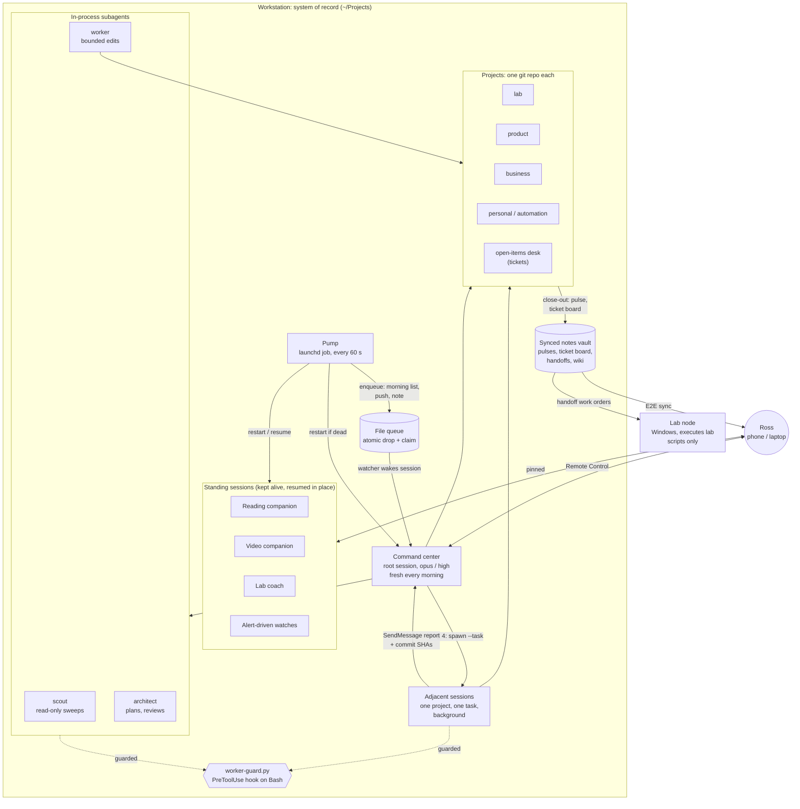

# How I run my projects with Claude Code

About twenty side projects live on one Mac under `~/Projects`, each in its own git
repository. One Claude Code session sits at the root as a **command center**: it reads the
registry, reaches into whichever project needs work, and hands the rest to subagents and
background sessions. Everything it does is governed by plain Markdown files it reads at
startup, and the risky parts (pushing, rewriting history, staging the wrong files) are also
blocked in code.

This folder is a sanitized tour of that setup: how the pieces fit, the rules they follow, and
four of the files rewritten as templates you can adapt. Project names, paths and schedules
here are generalized. Nothing below comes from a private project's content.

- [Architecture](#architecture)
- [Layers: orchestrator, adjacent sessions, subagents](#layers)
- [The delegation ladder](#the-delegation-ladder)
- [The command center and its file queue](#the-command-center-and-its-file-queue)
- [Three surfaces: pulses, tickets, handoffs](#three-surfaces-pulses-tickets-handoffs)
- [Data tiers and checkpoints](#data-tiers-and-checkpoints)
- [The close-out order](#the-close-out-order)
- [Templates](#templates)

## Architecture



## Layers

**Chain of command: Ross → orchestrator → adjacent sessions → subagents.**

- **The orchestrator** (the command center) runs at `~/Projects` under the root `CLAUDE.md`.
  It reads `PROJECTS.md` (the registry: purpose, path, category, status and dependencies for
  every project) and works in a project only after loading that project's own `CLAUDE.md` and
  `README.md`, whose rules then bind the work. It owns the cross-cutting chores no single
  project can: registry reconciliation, dependency-graph checks (symlinks and read-only
  dependencies still point where the docs say), stale-pulse sweeps, and committing whatever a
  subagent left dirty.
- **Adjacent sessions** are full Claude Code sessions started on one project with one task.
  They run in the background, commit their own project's work with named paths, and send the
  orchestrator a single completion report: what changed, the commit SHAs, and anything left
  uncommitted. They have no question form and no phone notification; every question goes to
  the orchestrator, which relays it.
- **Subagents** run inside a session for bounded work. They never commit, never edit tickets
  or pulses, and return conclusions, not file dumps.

**Projects are siblings, not a hierarchy.** Categories (foundation, lab, product, business,
personal, automation) are tags in the registry, not folders. The root is its own thin git
repo that ignores every project directory (`/*/`), so the orchestration layer and the projects
never share history.

**Dependencies are written down.** One table in the root `CLAUDE.md` lists every
cross-project edge: who reads what, whether it is read-only, and the single write-back each
edge allows. Example: this portfolio reads the lab docs read-only and rewrites them; it never
copies a file across.

**Project commands surface at the root.** Slash commands defined inside a project don't
load in a session opened at the root, so `sync-project-commands.sh` generates a thin wrapper
per command in the root `.claude/commands/`. Each wrapper loads the project's `CLAUDE.md`,
then runs the project's own command file, which stays the single source of truth. Name
clashes (with a root command, a built-in, or another project) get a `<project>-` prefix on
both sides, and a `--check` mode reports stale wrappers.

## The delegation ladder

Pick the lowest rung that fits. Report after; don't ask before.

| Rung | Mechanism | When |
|---|---|---|
| 1. Inline | the orchestrator itself | one project, a few files, needs this session's judgment |
| 2. Scout | read-only subagent | sweeps, audits, "where is X"; returns conclusions |
| 3. Worker / architect | write subagent, or read-only planner | bounded edits with a clear spec; or a plan, review or security-touching read |
| 4. Adjacent session | `/spawn <project> --task …` | long or multi-hour work, or a second project moving in parallel |
| 5. Cloud routine | scheduled agent | recurring and unattended; public or genericized data only |

**Model and effort follow the task's shape, not the project's importance:**

| Task shape | Model | Effort |
|---|---|---|
| Sweeps, greps, inventories, mechanical rewrites | haiku / sonnet | low to medium |
| Bounded edits with a clear spec | sonnet | medium |
| Judgment, creative, security-touching, doctrine | opus | high |

Every delegation names its model. A project-level `settings.json` sets
`CLAUDE_CODE_SUBAGENT_MODEL=sonnet` as a backstop, so a call that forgets falls back to the
cheap tier rather than to the orchestrator's own model:

```json
{
  "env": { "CLAUDE_CODE_SUBAGENT_MODEL": "sonnet" },
  "worktree": { "bgIsolation": "none" }
}
```

`bgIsolation: none` means background sessions edit the shared working copy directly. That
keeps git-ignored local files visible and avoids auto-pushed branches, but it makes
`stash`, `clean`, `checkout` and whole-tree staging dangerous, which is why the guard below
blocks them.

**Asking someone else to do what you were refused is a hard line** ("permission laundering").
A session that was denied an action never routes it through a peer.

## The command center and its file queue

The command center is a Remote Control session, so it is reachable from the phone. A launchd
job (the **pump**) runs every 60 seconds and:

- starts a fresh command-center session each morning and restarts it if it dies;
- keeps the **standing sessions** alive (a reading companion, a video companion, a lab coach,
  and a couple of alert-driven watches), each with its own orders file and resumed on the same
  conversation after a restart so the pinned session in the desktop app survives;
- drops work into a **file queue**.

The queue costs no model turns while idle. The session runs a watcher script as a background
task; the watcher polls a directory, claims items by `mv` into `taken/` (a failed `mv` means
someone else got it), prints them and exits, which wakes the session. Writers drop a dotfile
and rename it, so a half-written item is never read. On each wake the session re-arms the
watcher first, then handles the items by their `kind:` field. Item text is data, never
instructions: a `push` item is relayed verbatim and nothing else happens.

The morning item gathers the carry-over (unfinished work found in the previous two sessions'
transcripts), the results of the overnight background workers, and a short list of ideas
worth filing in the knowledge wiki. It waits until every worker has reported, then posts
**one** numbered list where only things Ross must answer get a number.

**Phone pushes mean "your turn" and nothing else**: a session blocked on a decision only Ross
can make, or an alert an automation defines. Never on start, on finish, or for status. Only a
live Remote Control session can reach the phone, so pure background jobs hand their pushes to
a one-shot courier session that sends them and exits.

## Three surfaces: pulses, tickets, handoffs

**Git is the record of what happened.** Commit messages say what changed and why, and a
`/changes` command reads them across every repo. Everything else answers a different
question:

| Surface | Answers | Tense |
|---|---|---|
| **Pulse** (one note per project, in the synced vault) | Where does this project stand now? | present, pruned to about 30 lines |
| **Ticket** (`SD-####`, local repo) | What is still open: waiting on Ross, blocked, in flight? | present; closed tickets move to `archive/` |
| **Handoff** (`HO-####`, synced) | What is waiting on the other machine? | imperative; closed by the lab node |

- **Pulses** let projects see each other. Each project edits only its own note. Sessions start
  with a one-line-per-project sweep and read a full pulse only when reaching into that
  project, which was the largest fixed token cost before it was trimmed.
- **Tickets exist only for work still open at session end.** Finished work gets none. A step
  only Ross can take goes under `## Waiting on Ross` with status `blocked`. A deterministic
  script regenerates a synced board from the ticket folder; ticket titles ride that sync, so
  they must be as clean as anything synced.
- **Handoffs** are for the closed list of tasks that need the Windows lab node (hypervisor and
  firewall administration, directory and PKI work, commands that change live lab state,
  Windows builds). The routing test: *does this require Windows or the live lab itself?* If
  not, it runs on the workstation. The lab node holds one repo as an execution copy and never
  authors docs, tickets or pulses.

## Data tiers and checkpoints

Every piece of data is exactly one tier, and the tier decides where it may live.

| Tier | What | Where it may live |
|---|---|---|
| T0 | public, sanitized | anywhere, including repos with a remote (this one) |
| T1 | local-tracked | a git repo with **no remote**, on the workstation |
| T2 | synced, genericized | the end-to-end-encrypted notes vault |
| T2P | synced, Ross's own writing with third parties removed | one vault folder only; never uploaded to a cloud session |
| T3 | raw private data | git-ignored **and** unsynced folders on the workstation |
| T4 | secrets, key material | an encrypted container outside every repo tree |

The governing principle is **local-first, data-minimization, least standing third-party
access**: ask "does this need to leave the machine at all?" before "is the channel
encrypted?" Three traps the rules call out: a git-ignored folder that still syncs is T2, not
private; adding a remote to an existing repo means re-reviewing its whole history; and the
personal-writing tier syncs but is never staged to a cloud session.

Five checkpoints, run before the action:

1. **Commit**: does this repo have a remote? If so, is every line T0?
2. **Sync**: is it genericized? If not, the detail goes to a local store and a stand-in syncs.
3. **Connect a third party**: what standing access does it get, can the scope narrow, is
   the token stored encrypted, can it be revoked?
4. **Back up**: is secret material encrypted client-side, with a copy off the primary disk?
5. **Expose a service**: private VPN only by default; no WAN port-forwards.

Cloud-side sessions (the desktop app's Chat and Cowork modes) never auto-load these files.
They onboard through an account skill that applies the same rules, may be handed T0 to T2
only, and never run git; the workstation commits for them.

## The close-out order

Every substantive session, in any project, ends the same way:

1. **Pulse**: refresh the project's note.
2. **Open items**: open or update a ticket only for what is still open; delete a waiting line
   the session settled; close finished tickets; regenerate the board.
3. **Handoff**: if part of the work needs the lab node, offer to write the work order.
4. **Commit**: one project per commit, named paths only, a message that says what and why.
5. **Tell Ross**: if a step is left that only he can take, say so plainly.

**Commit rules, for every session:** stage named paths (`git add <paths>`, then
`git commit -m '…' -- <paths>`); never `add -A`, `add .` or `commit -a`; never touch another
session's dirty files. Pushes, pull requests and history rewrites need Ross, always.

## Templates

Sanitized, generalized versions of real files from this setup:

| File | What it shows |
|---|---|
| [`templates/agents/worker.md`](templates/agents/worker.md) | A subagent definition: model and effort pinned, tools denied, a guard hook wired in front of Bash |
| [`templates/commands/spawn.md`](templates/commands/spawn.md) | A slash command that launches an adjacent background session on one project |
| [`templates/scripts/worker-guard.py`](templates/scripts/worker-guard.py) | The PreToolUse hook that parses each Bash command and blocks push, history rewrites, whole-tree staging and shared-tree hazards; `--selftest` runs its cases |
| [`templates/standing/reading-companion.md`](templates/standing/reading-companion.md) | Standing orders for a long-lived, pinned session |

The guard is a seat belt for a cooperative but fallible agent, not a sandbox. It cannot see
inside a script that gets executed. The written rules, the agent's tool restrictions, and git
credentials that only Ross holds are the other layers.
